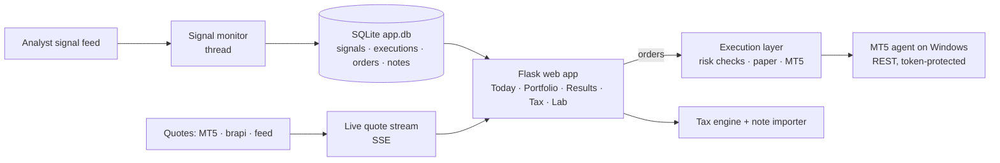

<div align="center">

# 📈 Trades Copilot

### A personal trading assistant that follows analyst signals, builds the order ticket, tracks real P&L and computes Brazilian income tax

*It tells you when an analyst opens or closes a trade, hands you a ready-to-send ticket, records what you actually executed (home broker or MetaTrader 5), imports brokerage notes, and shows whether you are really making money after costs, slippage and tax.*


</div>

---

> ⚠️ Personal project for the Brazilian market (B3). Not financial advice. Real-order execution is disabled by default and guarded by an explicit switch.

## ✨ What it does

| Step | Where |
|---|---|
| An analyst opens a signal → alert (browser, sound, optional Telegram) | always-on signal monitor |
| **Ready-made ticket**: quantity, limit price, max acceptable price, cost, max loss, warnings | **Today** |
| Execute at your broker (**Copy ticket** → **Executed**) or **Send to MT5** (with confirmation) | **Today** / **Signals** |
| Follow the position: average price, P&L, signal return, expiry, open orders | **Portfolio** |
| Analyst closes → **Pending exit** with an exit ticket | **Today** / **Portfolio** |
| Import a brokerage note → history is adjusted to the note (qty, price, date, real costs), withholding tax and fees calibrated | **Notes & Tax** |
| Real results, slippage vs. the analyst, CSV export | **Results** |
| Monthly income tax (closed with notes vs. estimated), DARF, "what if I close everything now", annual summary | **Notes & Tax** |
| Which analyst is worth following? Copy-trading backtest, screeners, AI, knowledge base | **Lab** |

### Highlights

- **Automatic matching of already-executed signals**: the analyst's warning usually arrives on WhatsApp before the API. If you already executed and logged the order, the app links it to the signal and shows "Already executed" instead of "New signal".
- **Similar open trade detection**: a new signal on the same underlying as one of your positions is shown with a warning.
- **Live quotes with graceful fallback**: MT5 (real time, bid × ask) → brapi.dev (free plan, with a daily request budget so it never runs out) → analyst-feed prices → manual. The UI streams prices over Server-Sent Events and falls back to polling if a proxy buffers the stream.
- **Order execution modes**: *Off*, *Simulation* (separate paper account) or *Real (MT5)*. Real mode needs `EXECUTION_ENABLED=true`, which the UI cannot flip by itself. Every order passes a confirmation modal with risk checks.
- **Guarded automation**: when *armed*, it can auto-send entries and exits under daily limits (entries per day, daily loss, value per order, exposure) and slippage bounds. Every decision is logged and a **panic button** disarms and cancels everything.
- **Brazilian tax engine**: monthly calculation with a calculation memo for stocks (R$ 20k monthly exemption), options, day trade, loss carry-forward (swing and day trade separate), withholding tax, DARF 6015 and annual summary. A month only counts as *closed* when every trading day has an imported note.
- **Brokerage note import** (SINACOR-style PDFs, password-protected supported): the note is the source of truth, with undo.

## 🏗️ Architecture



```text
web_app.py / wsgi.py       local server / gunicorn entry (Docker)
src/core/                  config, DB + migrations, B3 calendar, tickers/options
src/integrations/          signal-feed client with deduplication, quote sources (MT5, brapi)
src/services/              monitor, live quotes, ticket, journal/positions, portfolio, alerts, tax, results, notes
src/execution/             orders, risk, automation, connectors (paper, MT5 local/remote), MT5 agent
src/lab/                   copy-trading backtest, central-bank rates, on-demand TimesFM forecast
strategies/                screeners, options backtest, knowledge base, YouTube ingestion
web/                       Flask app, auth, API, templates and static UI
tests/                     pytest suite
```

Positions and P&L are always recomputed from executions (average price with costs; day trade separated from swing per day, as in tax filing).

## 🚀 Run it

**Docker**

```bash
git clone https://github.com/pjaragao/Trades.git && cd Trades
cp .env.example .env        # set COPILOTO_PASSWORD, TF_EMAIL, TF_PASSWORD (and BRAPI_TOKEN)
docker compose up -d --build   # http://localhost:5000, data in ./data
```

Behind an HTTPS reverse proxy use `COOKIE_SECURE=true` and `TRUST_PROXY=<number of proxies>`. Live quotes need unbuffered SSE on `/api/stream`.

**Windows (local)**

```bash
pip install -r requirements.txt
copy config\.env.example config\.env   # fill in credentials
python web_app.py                      # http://127.0.0.1:5000
```

**MetaTrader 5**: the `MetaTrader5` Python package only works on Windows, so a small **MT5 agent** (`start_mt5_agent.bat`, optional `--readonly`) runs next to the terminal and the containerized app talks to it over a token-protected HTTP API.

```bash
python -m pytest
```

---

<div align="center">

Built by **Paulo Aragão Jr** · [GitHub](https://github.com/pjaragao) · [LinkedIn](https://www.linkedin.com/in/paulojrarj)

</div>
